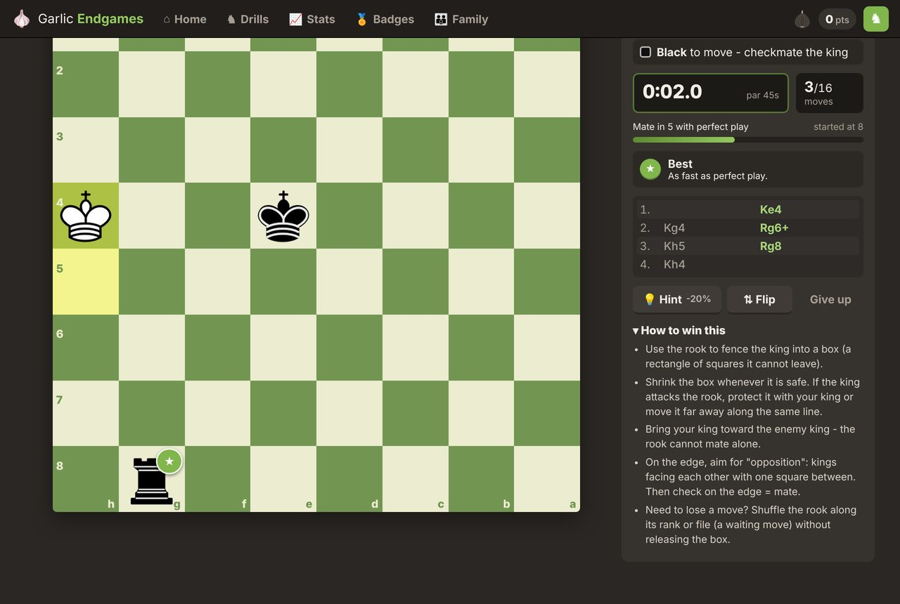
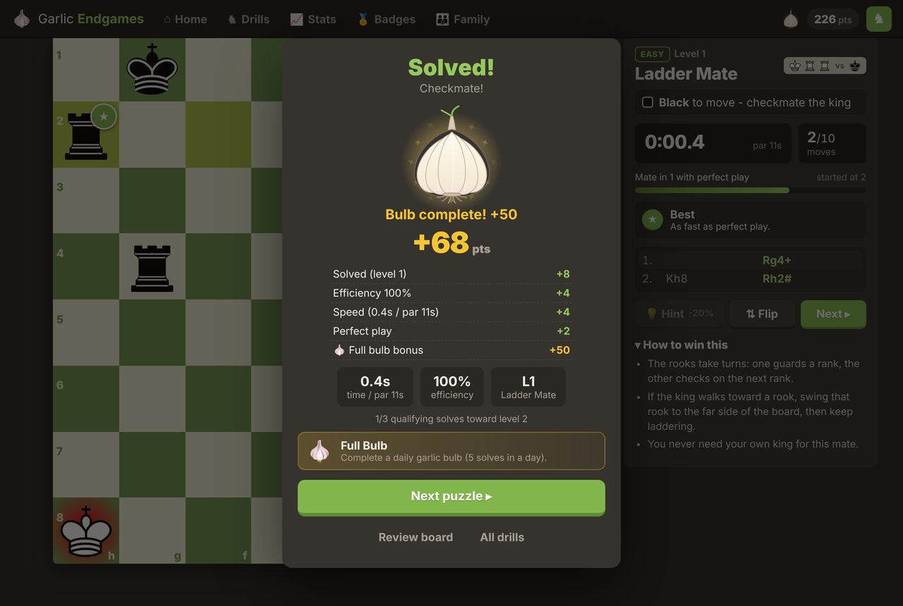
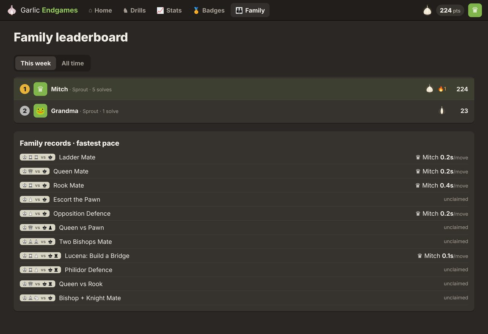
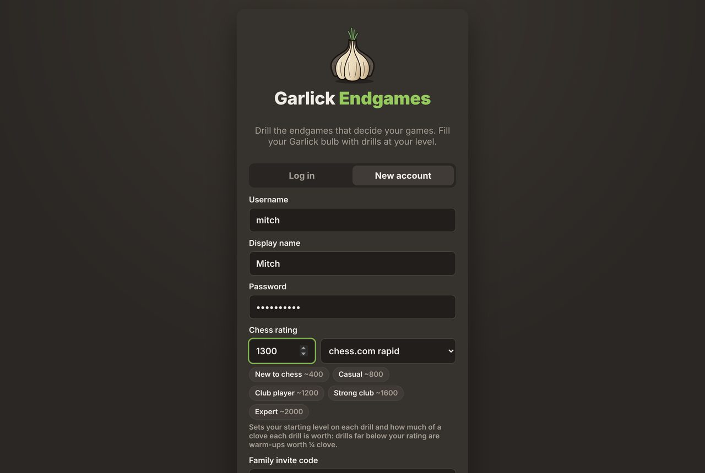
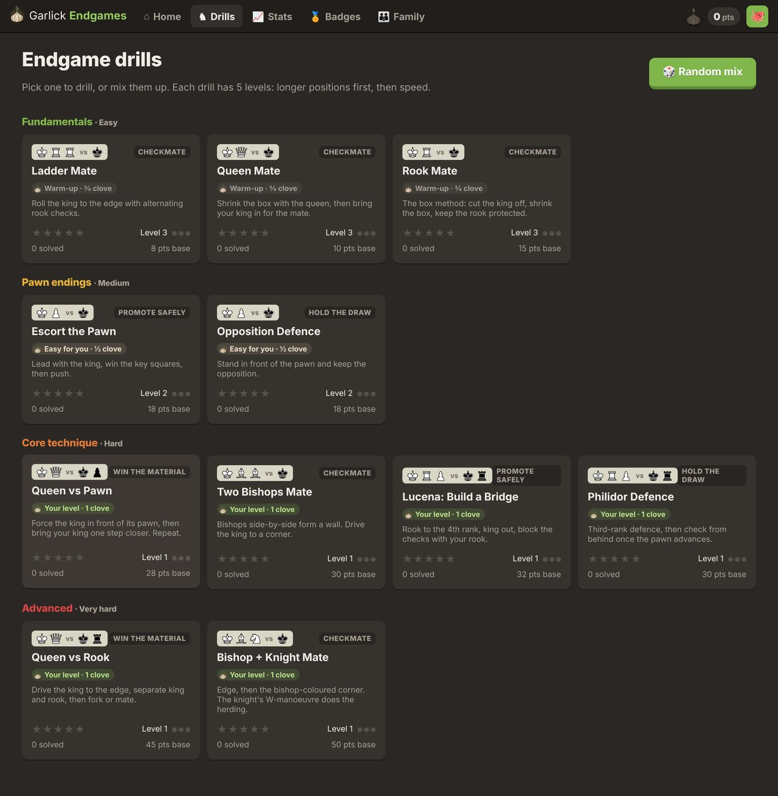
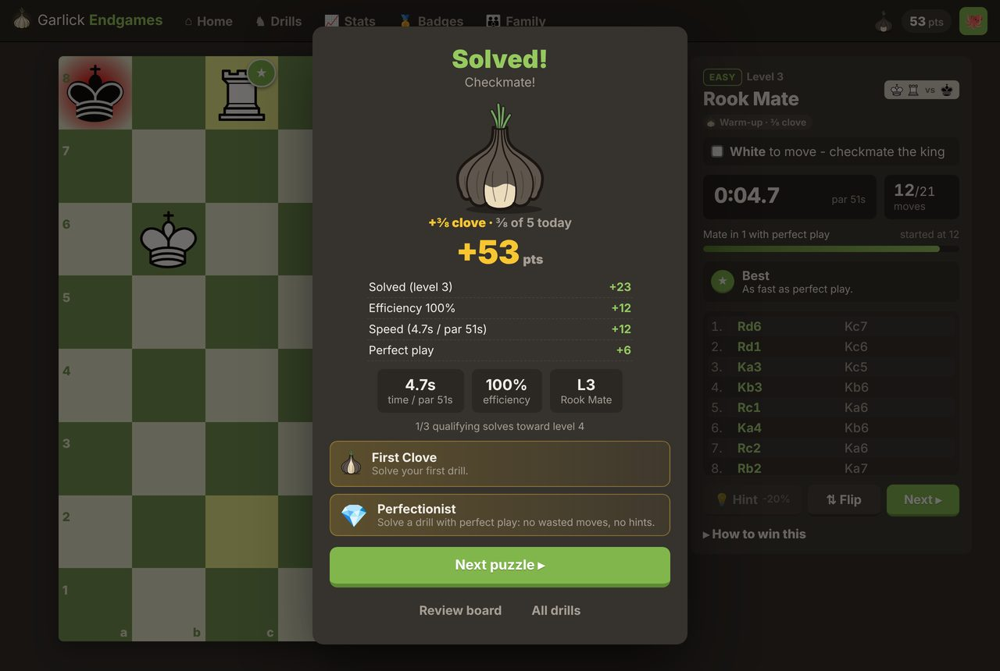

# Garlick Endgames


An endgame drill trainer for the family. Drill specific endgames (rook mate,
queen mate, Lucena, Philidor, bishop + knight and more) or play a random mix.
Every move is checked against a perfect endgame tablebase, so you get faster,
earn points and badges, and fill one clove of the daily Garlick bulb with every
solve.



## What's in it

* **11 drills in 4 difficulty tiers**, each with 5 levels (three for longer
  positions, then two speed levels):
  Ladder mate · Queen mate · Rook mate · Escort the pawn · Opposition defence ·
  Queen vs pawn · Two bishops · Lucena · Philidor · Queen vs rook · Bishop +
  knight.
* **Perfect move grading** from the Lichess tablebase: Best / Good / Inaccuracy
  / Mistake / Blunder, plus "only move" when defending. A move is only
  penalised hard if it changes the result. Slower-but-safe moves cost a little
  efficiency, and going in circles triggers a nudge. See
  [docs/DESIGN.md](docs/DESIGN.md).
* **Drag or tap** to move. The selected piece's square lights up and the piece
  glows, legal moves show as dots and rings, the computer's moves slide in, and
  there's a promotion picker.
* **Points** for solving, efficiency and speed against par, with penalties for
  hints and takebacks. Ranks run from Sprout to Garlick Grandmaster.
* **Daily Garlick bulb:** solves colour in cloves. A drill at your level
  fills a whole clove; easy drills fill half and warm-ups a quarter, with more
  at higher levels. Five cloves complete the bulb (+50 points): the stalks shoot
  up while it bounces, glows and sparkles. Completed bulbs build your streak.
* **26 badges**, a **family leaderboard** (weekly and all-time), **family
  records** (fastest pace per drill), and **stats** with pace trends and a
  30-day calendar.
* **Family accounts** with username, password and chess rating (chess.com,
  Lichess, FIDE, CFC, or a best guess). The rating sets your starting levels and
  how much each drill fills your bulb. Sign-up is open; an invite code can be
  switched on with `INVITE_CODE`.
* **Chess.com analysis** of your own games, which drives the "Recommended for
  you" cards. See [analysis/](analysis/) and
  [the report for ham_sandmitch](docs/reports/ham_sandmitch-endgames.md).

| Selection & legal moves | Blunder + takeback | Bulb complete |
|---|---|---|
|  |  |  |

| Home | Phone | Family |
|---|---|---|
|  |  |  |

| Sign-up with rating | Drills worth part of a clove | Partly filled clove |
|---|---|---|
|  |  |  |

## Live site

**https://endgames.garlick.ca**: a Cloudflare Worker with a D1 database, on
Cloudflare's free plan. The same Worker also answers at
`garlick-endgames.garlick-mitchell.workers.dev`. Sign-up is open: each person picks a username and password, and optionally
their chess rating.

## Run it locally

Requires **Node 22.13 or newer** (it uses the built-in `node:sqlite`; there are
no native modules to compile).

```bash
npm install
npm run build        # builds the client into client/dist
npm start            # serves app + API on http://localhost:8787
```

Development, with hot reload on http://localhost:5173:

```bash
npm run dev
```

Tests (grading, scoring, cloves, symmetry, the puzzle bank, the server and the
HTTP API):

```bash
npm test
```

### Settings (environment variables)

| Variable | Default | Purpose |
|---|---|---|
| `PORT` | `8787` | HTTP port (local server) |
| `DB_FILE` | `data/garlick.db` | SQLite file (local server) |
| `INVITE_CODE` | *(empty)* | If set, new accounts need this code. On Cloudflare it is a Worker secret |
| `COOKIE_SECURE` | *(auto)* | Session cookies are Secure on HTTPS. Set to `1` to force it behind a TLS proxy |
| `TABLEBASE_URL` | Lichess | Alternative tablebase endpoint |

## Deploying to Cloudflare

The same API code (`server/api.js`) runs on Node with SQLite and on Cloudflare
Workers with D1 (`worker/index.js`). The built client is embedded in the Worker
bundle, so the deploy is a single script upload plus a D1 binding.

* **With an API token** (Workers Scripts: Edit plus D1: Edit):
  `CLOUDFLARE_API_TOKEN=... INVITE_CODE=... npm run deploy`. This creates or
  reuses the D1 database, applies the schema, uploads the Worker and turns on
  workers.dev. Leave out `INVITE_CODE` to keep the current one.
* **Without a token**, as the live site was deployed: `npm run bundle` writes
  `deploy/worker.js`. Commit it, and the Cloudflare connector fetches it from
  this public repo by commit, checks its SHA-256 and uploads it. See
  [deploy/README.md](deploy/README.md).

The schema is created on first request too (`ensureSchema`), and new columns
are added automatically, so deploys never need a manual migration step.

## How it works

```
client/   React + Vite. Board (custom, pointer events), Garlick bulb (SVG), pages
server/   Fetch-style API (accounts, attempts, scoring, leaderboard, caching
          tablebase proxy) + Node server on node:sqlite
worker/   Cloudflare Worker entry + D1 adapter (same API)
deploy/   Built Worker bundle for token-free deploys
shared/   Code used by both sides: drill catalog, grading, scoring,
          achievements, board symmetries, and the 660-position puzzle bank
scripts/  generate-puzzles.mjs (builds the bank, verified against the
          tablebase), dev runner, e2e screenshot walkthrough
analysis/ chess.com game analysis (python-chess + Stockfish + tablebase)
docs/     DESIGN (scoring/penalties), RESEARCH, ROADMAP, reports
```

* **Move judging** uses the [Lichess tablebase API](https://tablebase.lichess.ovh)
  (Syzygy 7-piece, plus Gaviota distance-to-mate for 5 or fewer pieces). Every
  drill has 5 or fewer pieces, so judgements are exact. The server caches
  answers in SQLite; the browser falls back to Lichess directly if the server
  can't reach it.
* **Scoring** is computed in the browser for display and **recomputed on the
  server** from the same shared code.
* **Regenerate the puzzle bank:** `npm run puzzles` (about 1,000 tablebase
  lookups, around 10 minutes, rate-limited politely).

## Credits

* Chess pieces: "cburnett" set by Colin M.L. Burnett, from
  [Wikimedia Commons](https://commons.wikimedia.org/wiki/Category:SVG_chess_pieces),
  used under its BSD option (also available under GPL / GFDL / CC BY-SA 3.0).
* Endgame tablebase: [Lichess](https://lichess.org) (Syzygy by Ronald de Man,
  Gaviota by Miguel A. Ballicora).
* Move legality: [chess.js](https://github.com/jhlywa/chess.js).
