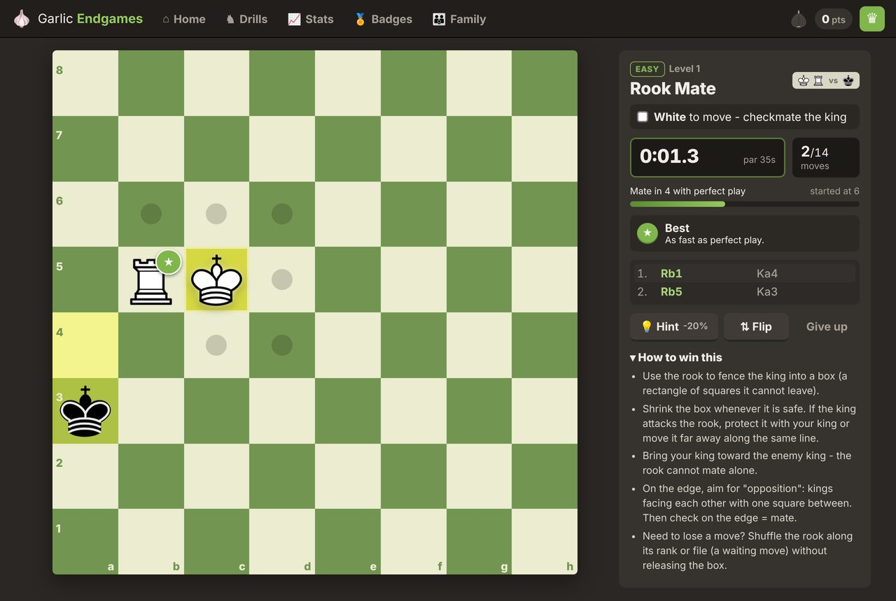
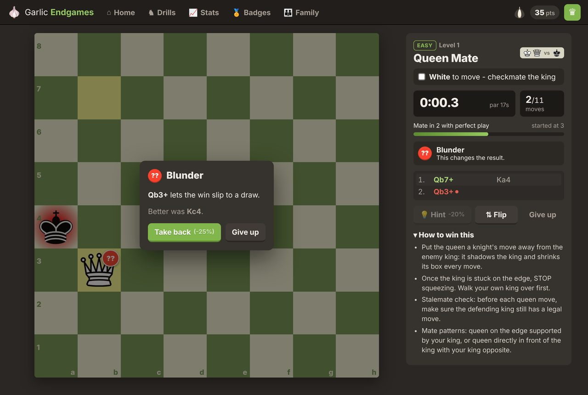
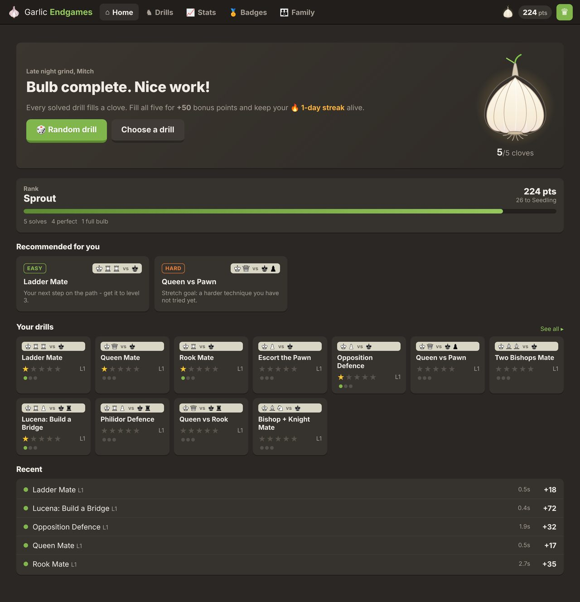
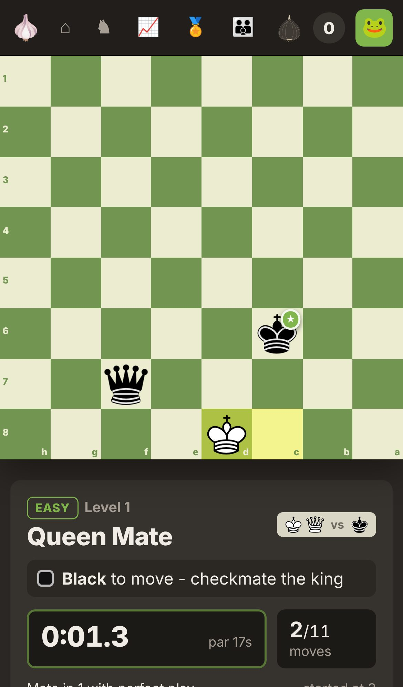

# 🧄 Garlic Endgames

An endgame drill trainer for the family. Drill specific endgames (rook mate,
queen mate, Lucena, Philidor, bishop + knight and more) or play a random mix.
Every move is checked against a perfect endgame tablebase, so you get faster,
earn points and badges, and fill one clove of the daily garlic bulb with every
solve.


## What's in it

* **11 drills in 4 difficulty tiers**, each with 5 levels (three for longer
  positions, then two speed levels):
  Ladder mate · Queen mate · Rook mate · Escort the pawn · Opposition defence ·
  Queen vs pawn · Two bishops · Lucena · Philidor · Queen vs rook · Bishop +
  knight.
* **Perfect move grading** from the Lichess tablebase: Best / Good / Inaccuracy
  / Mistake / Blunder, plus "only move" when defending. A move is only
  penalised hard if it changes the result. Slower-but-safe moves cost a little
  efficiency, and going in circles triggers a nudge. See
  [docs/DESIGN.md](docs/DESIGN.md).
* **Drag or tap** to move. The selected piece's square lights up and the piece
  glows, legal moves show as dots and rings, the computer's moves slide in, and
  there's a promotion picker.
* **Points** for solving, efficiency and speed against par, with penalties for
  hints and takebacks. Ranks run from Sprout to Garlic Grandmaster.
* **Daily garlic bulb:** each solve fills a clove; five fill the bulb (+50
  points) with a bounce, glow, sprout and sparkles, and keep your streak going.
* **26 badges**, a **family leaderboard** (weekly and all-time), **family
  records** (fastest pace per drill), and **stats** with pace trends and a
  30-day calendar.
* **Accounts** with username and password. Optionally require a family invite
  code to sign up.
* **Chess.com analysis** of your own games, which drives the "Recommended for
  you" cards. See [analysis/](analysis/) and
  [the report for ham_sandmitch](docs/reports/ham_sandmitch-endgames.md).

| Selection & legal moves | Blunder + takeback | Bulb complete |
|---|---|---|
|  |  |  |

| Home | Phone | Family |
|---|---|---|
|  |  |  |

## Run it

Requires **Node 22.13 or newer** (it uses the built-in `node:sqlite`; there are
no native modules to compile).

```bash
npm install
npm run build        # builds the client into client/dist
npm start            # serves app + API on http://localhost:8787
```

Development, with hot reload on http://localhost:5173:

```bash
npm run dev
```

Tests (grading, scoring, symmetry, the puzzle bank and the server):

```bash
npm test
```

### Settings (environment variables)

| Variable | Default | Purpose |
|---|---|---|
| `PORT` | `8787` | HTTP port |
| `DB_FILE` | `data/garlic.db` | SQLite file. Keep it on a persistent disk and back it up |
| `INVITE_CODE` | *(empty)* | If set, new accounts need this code. **Set it if the app is on the internet** |
| `COOKIE_SECURE` | *(empty)* | Set to `1` when served over HTTPS |
| `TABLEBASE_URL` | Lichess | Point this at your own tablebase server if you run one |

If the server sits behind a corporate or sandbox HTTPS proxy, run Node with
`NODE_USE_ENV_PROXY=1`.

### Hosting for the family

It is a single Node process plus one SQLite file, so any small host with a
persistent disk works: a Raspberry Pi or old laptop at home (with Tailscale for
access from phones), Fly.io or Railway (with a volume), or a small VPS. Put it
behind HTTPS and set `INVITE_CODE` and `COOKIE_SECURE=1`.

## How it works

```
client/   React + Vite. Board (custom, pointer events), garlic bulb (SVG), pages
server/   Express + node:sqlite. Accounts, attempts, scoring, leaderboard,
          caching proxy for the Lichess tablebase
shared/   Code used by both sides: drill catalog, grading, scoring,
          achievements, board symmetries, and the 660-position puzzle bank
scripts/  generate-puzzles.mjs (builds the bank, verified against the
          tablebase), dev runner, e2e screenshot walkthrough
analysis/ chess.com game analysis (python-chess + Stockfish + tablebase)
docs/     DESIGN (scoring/penalties), RESEARCH, ROADMAP, reports
```

* **Move judging** uses the [Lichess tablebase API](https://tablebase.lichess.ovh)
  (Syzygy 7-piece, plus Gaviota distance-to-mate for 5 or fewer pieces). Every
  drill has 5 or fewer pieces, so judgements are exact. The server caches
  answers in SQLite; the browser falls back to Lichess directly if the server
  can't reach it.
* **Scoring** is computed in the browser for display and **recomputed on the
  server** from the same shared code.
* **Regenerate the puzzle bank:** `npm run puzzles` (about 1,000 tablebase
  lookups, around 10 minutes, rate-limited politely).

## Credits

* Chess pieces: "cburnett" set by Colin M.L. Burnett, from
  [Wikimedia Commons](https://commons.wikimedia.org/wiki/Category:SVG_chess_pieces),
  used under its BSD option (also available under GPL / GFDL / CC BY-SA 3.0).
* Endgame tablebase: [Lichess](https://lichess.org) (Syzygy by Ronald de Man,
  Gaviota by Miguel A. Ballicora).
* Move legality: [chess.js](https://github.com/jhlywa/chess.js).
